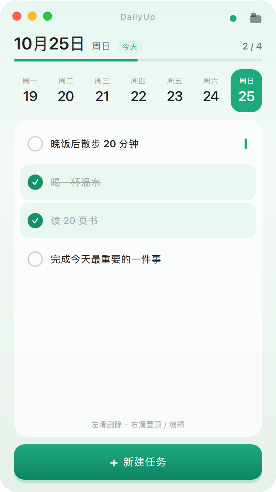
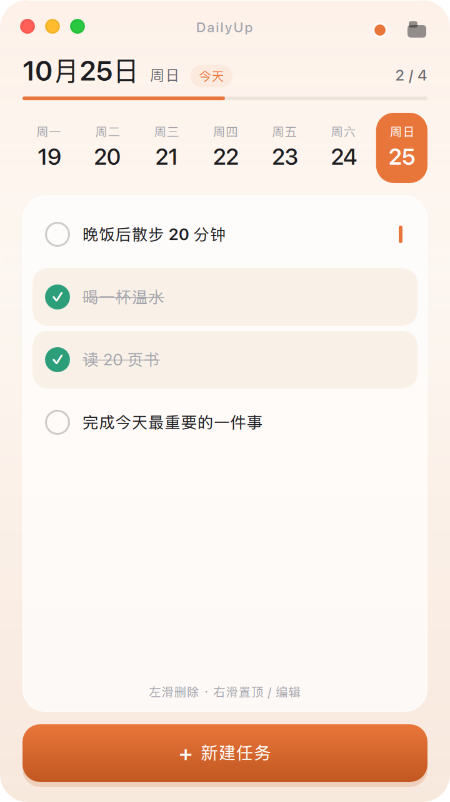
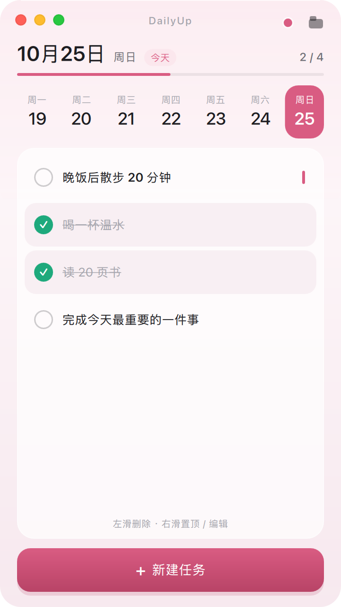
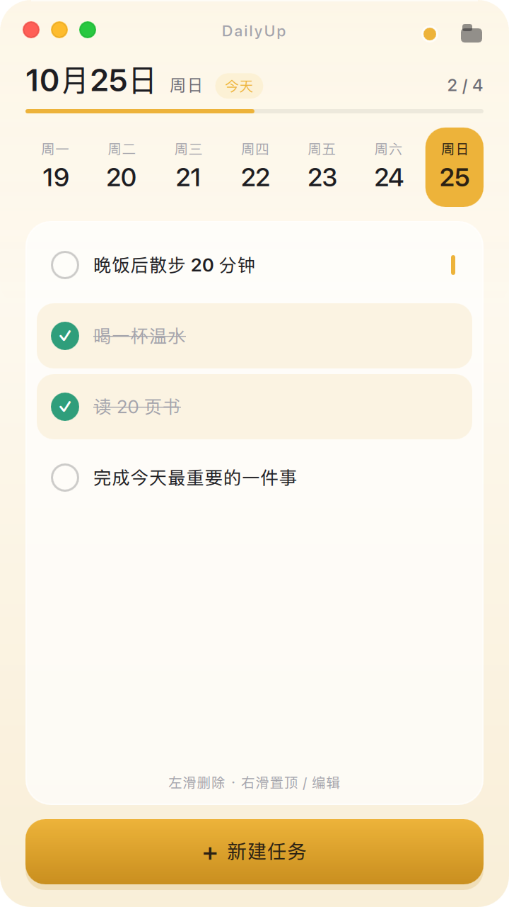
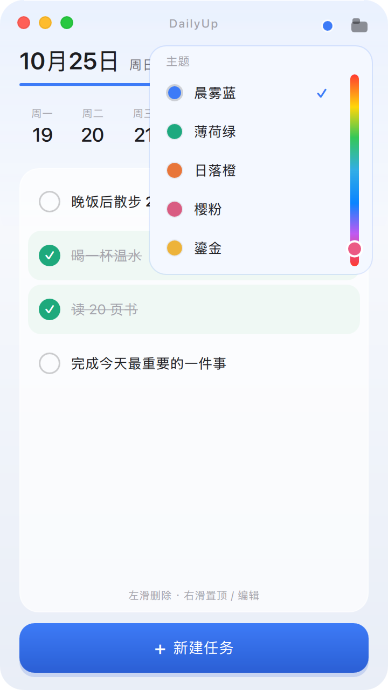
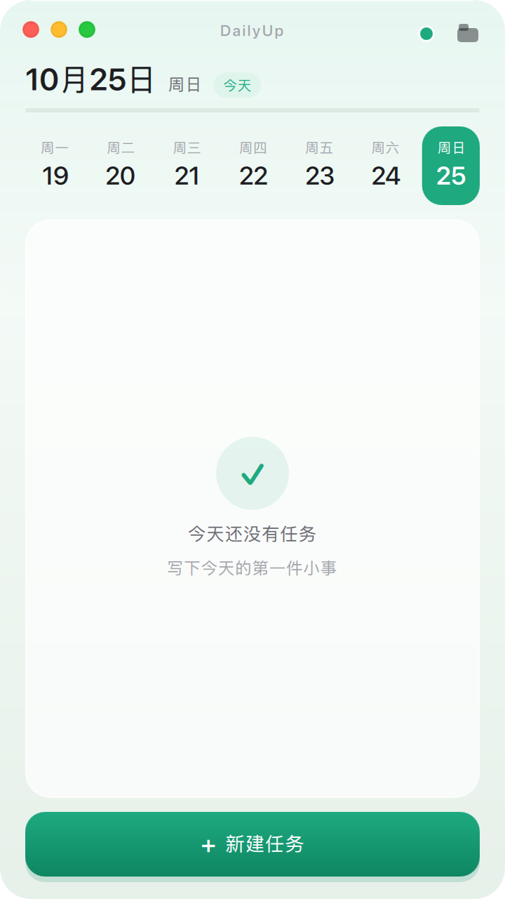

# DailyUp · 每日打卡

一个安静地待在桌面角落的每日任务清单。Qt 6 + Qt Quick (QML) + SQLite，本机存储，没有账号与云端。

这次把原来的 Windows 版本重做为 macOS 原生风格：无边框圆角窗口、红黄绿窗口按钮、五套主题与调色盘，保留「一天一页、跨日继承」的打卡逻辑。


## 五套主题 + 调色盘

主题在右上角的色点里切换，选择会写入 macOS 偏好设置，下次启动保持。

| 晨雾蓝 · 原生 | 薄荷绿 · 治愈 | 日落橙 · 温暖 |
| --- | --- | --- |
|  |  |  |

| 樱粉 · 柔和 | 鎏金 · 明亮 | 主题与调色盘 |
| --- | --- | --- |
|  |  |  |

主题同时改变：背景渐变、强调色、日期选中块、进度条、新建按钮、勾选色与弹层按钮。所有颜色集中在 `Theme.qml`，新增预设只需要在 `palettes` 里加一组值。

主题浮层右侧是一条竖向色相带：从上到下依次经过红、黄、绿、青、蓝、紫，拖动即可选任意色相。选择后由强调色自动派生浅色、深色、背景与完成态，保证五套预设和自定义色共用同一套层级与对比度逻辑；自定义色同样写入偏好设置。

| 新建任务 | 空状态 |
| --- | --- |
|  |  |

## 功能

- **一天一页**：最近七天横向切换，今天固定在最右；选中日高亮，今天保留淡色标记。
- **打卡**：点击任务切换完成状态，顶部实时显示「已完成 / 总数」与细进度条。
- **手势**：左滑任务露出「删除」，右滑露出「置顶 / 编辑」，松手吸附。
- **置顶**：置顶任务排在列表最前，右侧有强调色小竖条。
- **跨日继承**：启动时若今天还没有任务，会把最近一次使用那天的任务复制到今天，只继承文字内容；完成与置顶状态都清零。跨过零点时自动切换。
- **空状态**：没有任务时显示安静的引导，而不是空白列表。
- **主题**：五套预设 + 调色盘自定义色，自动派生背景、浅色与深色；选择持久化。
- **本地优先**：SQLite 单文件，无网络请求、无账号、无埋点。

## macOS 版做了什么

### 工程与配置

- `CMakeLists.txt`：Qt 6.5+，C++17，Ninja / Xcode 均可；macOS 应用包名为 `DailyUp.app`，Bundle ID `com.zes.dailyup`，最低系统 **macOS 14.4**。
- `Info.plist.in`：显式生成 `CFBundleExecutable`、版本、图标、`LSMinimumSystemVersion`、`LSApplicationCategoryType`、`NSHighResolutionCapable` 等字段，保证 Finder 双击可启动。
- `assets/DailyUp.icns`：由 `scripts/make_icon.py` 生成（1024 网格、圆角方形、蓝色渐变 + 白色对勾），16–512@2x 全套尺寸。
- `scripts/build_macos.sh`、`scripts/package_macos.sh`：构建、macdeployqt、ad-hoc 签名、DMG（受限环境自动回退 zip）。
- **SDK 回退**：macOS 27 SDK 与较旧 Command Line Tools 链接器会出现 `tapi error: malformed file`。CMake 会在 `project()` 之前检查缓存，即使 Qt Creator 复用旧构建目录，也会把 SDK 27 纠正为 26.5，并把宿主机部署目标（如 26.6）纠正为 14.4。如果本机链接器已支持 SDK 27，可加 `-DDAILYUP_SDK_FALLBACK=OFF` 关闭回退。
- **设置存储**：`AppSettings` 通过 `QSettings` 写入 `~/Library/Preferences/com.zes.DailyUp.plist`，保存主题、调色盘自定义色与窗口尺寸。
- **数据迁移**：旧版本可执行文件名为 `appDailyUp`，首次启动会把旧数据目录里的 `dailyup.db` 复制到新目录。
- **深色模式**：界面是固定浅色设计，启动时显式设置浅色方案，避免系统深色模式影响原生控件。

### 界面

- 无边框、透明窗口、22px 圆角；自绘 macOS 红黄绿按钮（悬停显示 × − +，窗口失焦时变淡）。
- 空白标题栏可拖动；右下角与右/下边缘可缩放；窗口尺寸记忆。
- 顶部字标、日期、今天徽标、完成计数、进度条组成清晰的头部层级。
- 卡片式任务区、10px 小号辅助文字、轻微 hover 与状态过渡动画。
- 新任务/编辑使用轻遮罩弹窗；弹窗与主题浮层不再叠加灰色阴影，主题浮层用一层极淡的强调色描边区分边界。
- 窗口去除系统投影与深色描边，圆角之外完全透明；弹窗遮罩也按同样的圆角裁剪，不再出现方形灰边。
- 如果数据库文件被复制成只读（444）或带上 quarantine 属性，启动时会自动恢复写权限并清除隔离属性；保存失败时会在界面底部弹出提示。

## 快速开始

### 环境

- Qt **6.5+**（在 **6.12.0** 上开发验证）
- CMake **3.21+**
- C++17 编译器
- macOS 14.4+（Apple Silicon 或 Intel）

### macOS 命令行

```bash
export QT_ROOT="$HOME/Qt/6.12.0/macos"
./scripts/build_macos.sh Release
open build/release/DailyUp.app
```

或手动：

```bash
cmake -S . -B build/macos -G Ninja \
  -DCMAKE_PREFIX_PATH="$HOME/Qt/6.12.0/macos" \
  -DCMAKE_BUILD_TYPE=Release
cmake --build build/macos
open build/macos/DailyUp.app
```

### Qt Creator

1. 打开 `DailyUp/CMakeLists.txt`。
2. 选择 Desktop Qt 6.12.0 macOS 套件。
3. 构建并运行。

### Windows

`CMakeLists.txt` 保留了 Windows 分支（`app.rc` 图标、`WIN32_EXECUTABLE`）。用 MSVC 2022 64-bit 套件构建即可；界面与逻辑跨平台，没有使用 macOS 专有 API。

## 打包

```bash
./scripts/package_macos.sh
```

产物：

- `dist/DailyUp.app`：已用 macdeployqt 拷贝 Qt 框架与 QML 模块，并做 ad-hoc 签名。
- `dist/DailyUp-1.0.0.dmg`：正常环境下的安装包；如果所在环境不允许挂载临时卷（CI / 沙箱），会自动生成 `dist/DailyUp-1.0.0-macos.zip`。

面向其他用户分发时，请把 ad-hoc 签名换成自己的 Developer ID，并完成 notarization。

## 数据与设置

| 内容 | 路径 |
| --- | --- |
| 数据库 | `~/Library/Application Support/Zes/DailyUp/dailyup.db`（WAL 模式） |
| 主题、自定义色与窗口尺寸 | `~/Library/Preferences/com.zes.DailyUp.plist` |
| 旧版本数据 | `~/Library/Application Support/appDailyUp/`（或同级的 `Zes/appDailyUp/`），首次启动自动迁移 |

开发 / 截图时可用 `DAILYUP_DATA_DIR=/tmp/dailyup` 隔离数据。

## 快捷键

| 快捷键 | 功能 |
| --- | --- |
| Cmd + N | 新建任务 |
| Cmd + , | 打开主题选择 |
| Cmd + W / Cmd + Q | 退出 |
| Return | 弹窗内确认 |
| Esc | 关闭弹窗 / 主题浮层 |

## 开发参数

```bash
# 指定尺寸与主题截图（不进入交互）
./build/release/DailyUp.app/Contents/MacOS/DailyUp \
  --size 360x640 --theme mint \
  --screenshot /tmp/dailyup.png --delay 900

# 填入演示任务（配合 DAILYUP_DATA_DIR 使用）
DAILYUP_DATA_DIR=/tmp/dailyup-demo \
  ./build/release/DailyUp.app/Contents/MacOS/DailyUp --demo

# 验证实时换肤 / 直接打开界面
... --switch-theme sunset
... --open theme | add | edit
```

## 工程结构

```
DailyUp/
├── CMakeLists.txt
├── Info.plist.in
├── main.cpp                  入口、应用元信息、截图 / 演示参数
├── AppSettings.{h,cpp}       主题与窗口尺寸（QSettings）
├── TaskManager.{h,cpp}       任务模型、跨日检测、完成计数
├── databasemanager.{h,cpp}   SQLite、WAL、跨日继承、数据迁移
├── Main.qml                  无边框窗口、布局、交互
├── Theme.qml                 五套配色 + 调色盘 / 圆角 / 间距（单例）
├── DateStrip.qml             最近七天日期条
├── TaskRow.qml               任务行与左右滑操作
├── TaskDialog.qml            新建 / 编辑弹窗
├── ThemePicker.qml           主题浮层
├── WindowControls.qml        macOS 红黄绿按钮
├── assets/
│   ├── DailyUp.icns
│   └── DailyUp-1024.png
├── images/app_icon.png
├── scripts/
│   ├── build_macos.sh
│   ├── package_macos.sh
│   └── make_icon.py
└── docs/screenshots/
```

## 与原 Windows 版的差异

- 窗口从「贴桌面边缘、边界回弹」改为系统级拖动 / 缩放，红黄绿按钮改为 macOS 位置与配色。
- 视觉从纯色块改为渐变背景 + 半透明卡片 + 柔和阴影。
- 日期条从横向滚动改为七天自适应铺满，窄窗与宽窗都不留空。
- 增加完成进度、空状态、主题浮层、快捷键盘操作与窗口尺寸记忆。
- 任务数据表结构、跨日继承规则与左右滑手势保持兼容。

## 已知限制

- 固定浅色主题，不跟随系统深色模式。
- 仅本地存储，没有云同步与多设备。
- 没有通知与提醒。
- 调色盘以色相选择为主，未提供完整的饱和度/亮度编辑器。

## 致谢

- Qt 6 / Qt Quick / Qt Quick Controls / Qt Quick Effects
- 应用图标由 `scripts/make_icon.py`（Pillow + NumPy）生成
- 界面没有引入第三方 Qt 组件库，窗口、图表式进度与阴影均使用 Qt 自带能力实现

## License

MIT