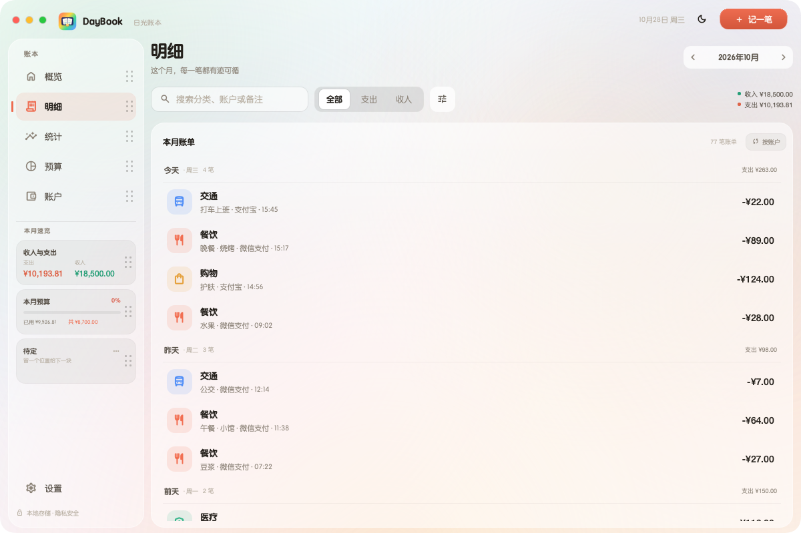
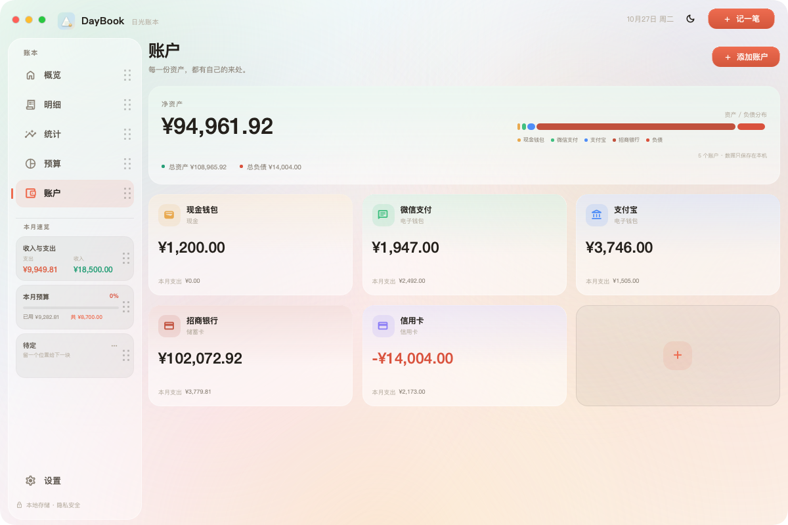
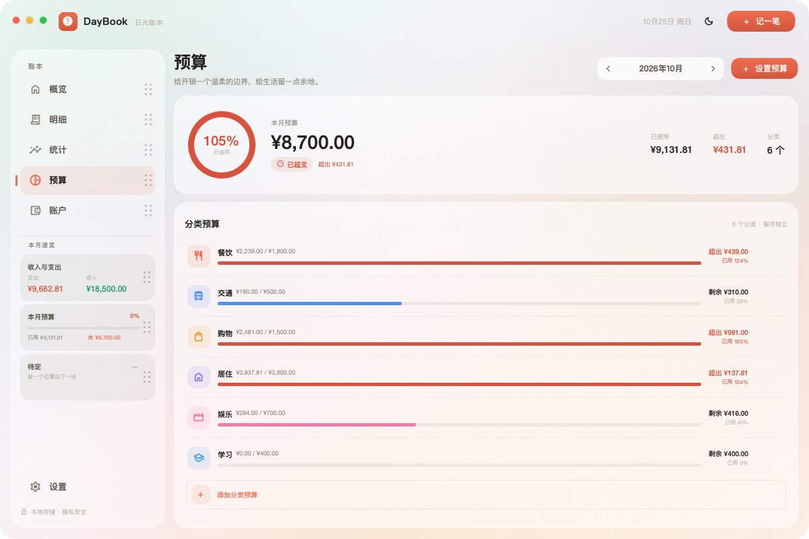
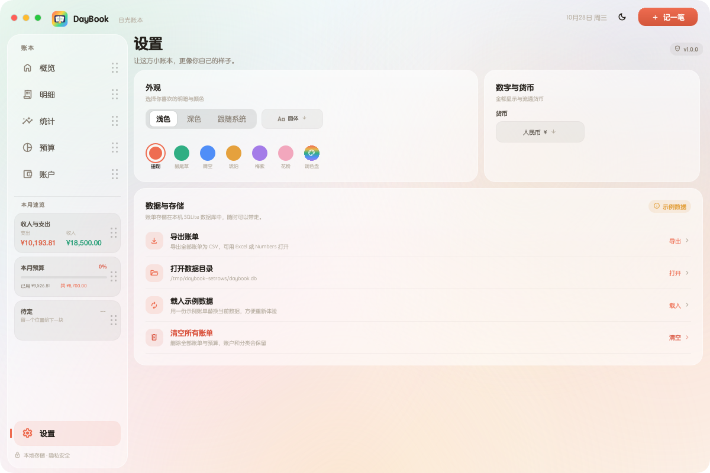
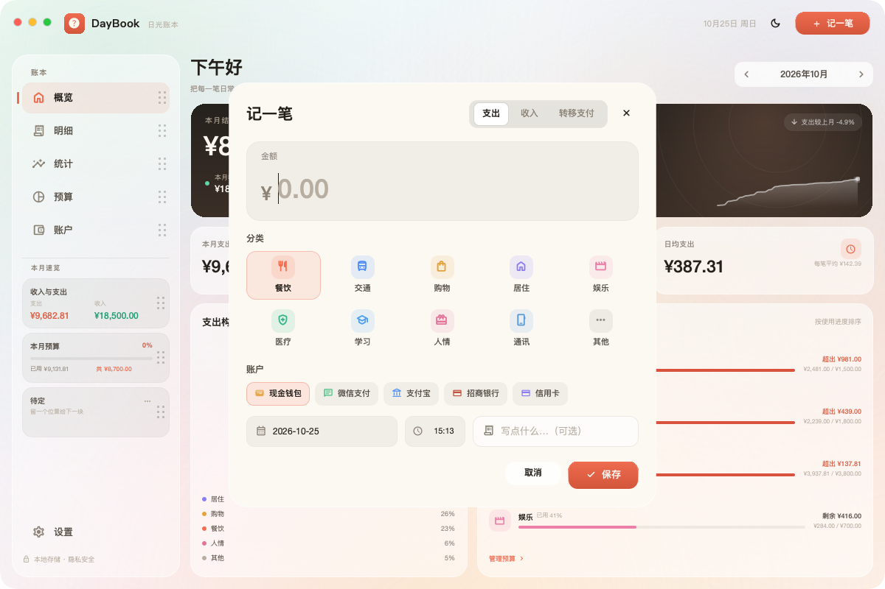

# DayBook · 日光账本

一个安静、本地优先的桌面记账应用。用 Qt 6 + Qt Quick (QML) 构建，使用 SQLite 保存数据，支持 macOS 与 Windows。

## 特性

- **概览**：单页式仪表盘，本月结余、收支、日均支出、支出构成和“分类预算”列表。
- **明细**：按日期分组，支持关键词搜索、收支类型筛选、分类/账户筛选、按月切换、编辑与删除；“记一笔”支持账户间转移支付；本月账单可翻转为账户账单，并支持在列表顶部/底部继续拖动切换月份。
- **统计**：三张月度摘要卡与概览共用，点击本月支出 / 本月收入可直达对应明细筛选；支出走势与收支构成并排，走势支持本季度 / 本月 / 近七天切换；近 6 个月收支 / 星期分布、预算执行 / 分类排行分别合并为可翻转卡片。
- **账户**：多账户、净资产、总资产/总负债、资产/负债分布，点击账户卡查看该账户本月流水，账户卡支持拖动排序并持久化，账户编辑与归档，账户颜色支持自定义调色盘及金/银预设。
- **预算**：按分类设置每月预算，支持自定义预算对象，进度、剩余/超支提示，总预算环形进度；列表末尾常驻“添加分类预算”入口。
- **设置**：浅色/深色/跟随系统、5 种预设强调色 + 花粉 + 调色盘（共 7 个强调色入口）、字体切换、独立“数字与货币”卡（6 种货币切换）、CSV 导出、打开数据目录、示例数据、清空数据；软件信息通过左上角 Logo 弹窗查看。
- **细节**：无边框圆角窗口、淡绿/淡蓝/淡粉/淡红/淡橙/淡金的柔和背景渐变、轻微磨砂玻璃层、卡片内部阴影、噪点纹理、Tabular 数字、页面淡入、全局 Toast；可滚动页面使用按需出现、自动淡出的细进度条；弹窗不铺灰色遮罩。
- **动态侧栏**：概览/明细/统计/账户/预算，以及“本月速览”的收入与支出/本月预算/待定，都是可拖拽重排的块；直接按住块上下拖动，松手即可换位，右侧圆点作为抓手指引，顺序写入本机设置。
- **本地优先**：没有账号、没有云端、没有埋点；数据只在本机的 SQLite 数据库中。

## 界面预览

| 浅色概览 | 深色概览 |
| --- | --- |
|  |  |

| 明细 | 统计 |
| --- | --- |
|  |  |

| 账户 | 预算 |
| --- | --- |
|  |  |

| 设置 | 记一笔 |
| --- | --- |
|  |  |

## 设计思路

- 整体是 26px 圆角的无边框窗口，窗口外围不再保留透明外框或描边，内容直接贴窗口边界；默认 1200×800，最小 860×600；窗口缩小时通过压缩页头、卡片高度和间距保持内容完整，不缩放文字；绿色按钮进入原生全屏，顶部可以贴合 MacBook 刘海区域；窗口控制按钮是自绘的红黄绿圆点。
- 背景不是一张图片，而是一层柔和的线性渐变 + 多个大半径径向光晕，再叠加极轻的噪点；卡片使用半透明白色/黑色和高光边，形成磨砂玻璃的感觉。
- 所有界面图标来自 Material Symbols Rounded 的可变字体子集；应用图标为多巴胺渐变底上的对称奶油色账本：左右镜像账页、青绿账目线、深蓝书封与金色 ¥ 硬币；数字使用 tabular figures，账目金额对齐更整齐。
- 图表全部自绘：面积图、环形图、分组柱状图、迷你折线图和环形进度。没有引入第三方图表库。
- 颜色、字体、圆角、间距集中在 qml/Theme.qml 中；修改强调色会立即影响按钮、选中态、图表与高亮。

## 参考的 8 个开源项目

动手前横向阅读了以下项目的 README、截图和功能列表。这里只借鉴信息架构与交互，没有复制源代码。

| 项目 | 值得借鉴 | 明确不照搬 |
| --- | --- | --- |
| [Actual Budget](https://github.com/actualbudget/actual)（约 29.7k stars） | 信封式预算、月份上下文、本地优先、预算进度 | 自建服务器/同步服务的部署成本 |
| [Cashew](https://github.com/jameskokoska/Cashew)（约 4.7k stars） | 亲切的分类图标、分类预算卡、暗色模式 | 移动端优先的导航层级与冗长引导 |
| [Money Manager Ex](https://github.com/moneymanagerex/moneymanagerex)（约 2.3k stars） | 账户类型、搜索/筛选、报表视角 | 传统桌面表单密度与较旧控件 |
| [Firefly III](https://github.com/firefly-iii/firefly-iii)（约 25k stars） | 分类洞察、规则思维、丰富报表 | 服务端安装与偏重的配置体系 |
| [GnuCash](https://github.com/Gnucash/gnucash)（约 4.4k stars） | 复式记账的严谨、净资产/负债概念 | 账本树与复式入门门槛 |
| [KMyMoney](https://github.com/KDE/kmymoney)（约 0.2k stars） | 预算、账户、定期交易的产品完整性 | KDE 桌面依赖与复杂设置 |
| [Paisa](https://github.com/ananthakumaran/paisa)（约 3.2k stars） | 安静的单页概览、留白与视觉层级 | 纯文本账本导入的学习成本 |
| [HomeBank](https://homebank.free.fr) | 定期账单、导入、简单报表的实用性 | 偏旧的界面与信息密度 |

这些参考直接影响了本轮调整：

- 概览改为 **Paisa 式单页平静仪表盘**：不滚动、不堆功能，只保留结余、预算、构成和提醒。
- 预算页改为 **Actual 式信封预算**：分类预算列表在卡片内独立滚动，超支优先提醒。
- 明细筛选修复后，参考 **Money Manager Ex** 强化类型/分类/账户/搜索的联动与可预期性。
- 统计页吸收 **Firefly III / Cashew** 的走势、排行、星期分布，把「支出走势」从概览移到统计。
- 账户页吸收 **GnuCash / KMyMoney** 的净资产与负债视角，但不引入复式记账术语。
- 没有照搬任何项目的代码或视觉资产；图标字体单独遵循 Apache 2.0。

## 快速开始

### 环境

- Qt **6.9+**（在 **Qt 6.12.0** 上开发和验证；使用 RectangularShadow 与可变字体轴）
- CMake **3.21+**
- C++17 编译器
- macOS 14.4+ / Windows 10+（Windows 使用 Qt 的 MSVC 2022 64-bit 套件）

### 用 Qt Creator

1. 打开 Qt Creator，选择“打开项目”，指向 DayBook/CMakeLists.txt。
2. 选择 Desktop Qt 6.12.0 套件（macOS: clang arm64；Windows: MSVC 2022 64-bit）。
3. 直接构建并运行。

macOS 上如果遇到 tapi error: malformed file，通常是本机 macOS 27 SDK 与旧链接器不匹配。项目的 CMake 会自动尝试回退到已安装的 26.x SDK；如果仍然失败，可在 CMake 配置中显式设置：

    -DCMAKE_OSX_SYSROOT=/Library/Developer/CommandLineTools/SDKs/MacOSX26.5.sdk

### macOS 命令行

    export QT_ROOT="$HOME/Qt/6.12.0/macos"
    ./scripts/build_macos.sh

构建产物：build/DayBook.app。

也可以手动执行：

    cmake -S . -B build -G Ninja \
      -DCMAKE_PREFIX_PATH="$HOME/Qt/6.12.0/macos" \
      -DCMAKE_BUILD_TYPE=Release
    cmake --build build

### Windows 命令行

在“x64 Native Tools Command Prompt for VS 2022”或 Qt Creator 的 MSVC 套件中：

    cmake -S . -B build -G "Visual Studio 17 2022" -A x64 ^
      -DCMAKE_PREFIX_PATH=C:\Qt\6.12.0\msvc2022_64
    cmake --build build --config Release

或直接使用打包脚本（会构建、部署 Qt 运行时并压缩）：

    powershell -ExecutionPolicy Bypass -File scripts\package_windows.ps1 ^
      -QtRoot C:\Qt\6.12.0\msvc2022_64

产物：dist/DayBook/DayBook.exe 与 dist/DayBook-1.0.0-windows-x64.zip。

> 开发机为 macOS，Windows 代码路径和打包脚本已经准备好，但尚未在真实 Windows 机器上做最终回归。应用不使用 macOS 专有 API，窗口、拖拽与缩放均通过 Qt 跨平台接口实现。

## 打包

### macOS DMG

    ./scripts/package_macos.sh

会使用 macdeployqt 拷贝 Qt 框架与插件，做 ad-hoc 签名，并生成：

- dist/DayBook.app
- dist/DayBook-1.0.0.dmg

面向其他用户分发时，请使用自己的 Developer ID 替换 ad-hoc 签名，并完成 notarization：

    codesign --force --deep --sign "Developer ID Application: ..." dist/DayBook.app
    xcrun notarytool submit dist/DayBook-1.0.0.dmg --wait ...

## 数据与隐私

- macOS 数据目录：~/Library/Application Support/DayBook/
- Windows 数据目录：%LOCALAPPDATA%\DayBook\
- 数据库：daybook.db（SQLite，WAL 模式）
- 主题、强调色：QSettings（macOS 偏好设置 / Windows 注册表）
- 首次启动会生成 6 个月的示例数据，方便直接看到完整界面；之后不会再次自动生成。
- 设置 → 数据与存储 → 清空所有账单会保留账户和分类，并移除示例账单；重启不会恢复示例数据。
- 导出 CSV 包含全部账单，使用 UTF-8 BOM，Excel 可直接打开。

### 数据表

- accounts：账户名称、类型、图标、颜色、初始余额、归档状态
- categories：支出/收入分类、图标、颜色、排序
- transactions：类型、金额（REAL 小数）、账户、分类、备注、发生时间
- budgets：分类 + 月份 + 预算金额（REAL 小数），唯一约束 (category_id, month)
- meta：首次运行标记、示例数据标记等

金额直接以真实小数的 REAL 字段存储；旧版数据库中的整数分会自动除以 100 迁移到新字段。

## 工程结构

    DayBook/
      CMakeLists.txt
      Info.plist.in              macOS Bundle 信息
      src/
        main.cpp                 入口、自测、截图工具
        database.*               SQLite schema、示例数据、CSV、备份
        models.*                 Transaction/Account/Category/Budget 模型
        appcontroller.*          业务逻辑、统计聚合、QML 单例 App
      qml/
        Main.qml                 自绘窗口、侧边栏、顶栏、路由
        Theme.qml               颜色/字体/圆角/间距
        Icons.qml               Material Symbols 图标映射
        UiBus.qml               页面间的事件总线（Toast/打开弹窗）
        components/             玻璃卡片、按钮、输入框、弹窗、进度、账单行…
        charts/                 面积图、环形图、柱状图、迷你折线图
        pages/                  概览、明细、统计、账户、预算、设置
      assets/
        fonts/DayBookIcons.ttf  Material Symbols Rounded 子集
        noise.png               磨砂噪点纹理
        DayBook.icns/.ico/.png  应用图标
      scripts/
        build_macos.sh
        package_macos.sh
        package_windows.ps1
      docs/screenshots/

C++ 类型通过 Qt QML 模块注册：import DayBook 后可直接使用 App、Theme、Icons、UiBus 和所有组件。

## 快捷键

- Cmd/Ctrl + N：记一笔
- Cmd/Ctrl + F：在明细页聚焦搜索
- Cmd/Ctrl + 1…5：切换概览 / 明细 / 统计 / 账户 / 预算
- Cmd/Ctrl + ,：设置
- Cmd/Ctrl + W：关闭窗口
- Cmd/Ctrl + Q：退出

## 开发工具

    # 页面启动
    ./build/DayBook.app/Contents/MacOS/DayBook --page insights

    # 启动时打开弹窗
    --modal add|account|budget|filter|filtertype|date|month

    # 指定窗口尺寸并截图（用于文档）
    --size 1200x800 --screenshot /tmp/daybook.png --delay 2500

    # 后端自测：使用隔离的测试数据目录，测完即退出
    QT_QPA_PLATFORM=offscreen ./build/DayBook.app/Contents/MacOS/DayBook --selftest

环境变量：

    DAYBOOK_THEME=light|dark|system
    DAYBOOK_ACCENT=coral|sage|azure|amber|plum|pollen|custom
    DAYBOOK_CUSTOM_ACCENT=#RRGGBB
    DAYBOOK_FONT=system|serif|rounded|kai
    DAYBOOK_CURRENCY=CNY|USD|EUR|JPY|GBP|HKD
    DAYBOOK_DATA_DIR=/tmp/daybook-data   # 隔离数据目录（开发/截图用）

## 自测覆盖

--selftest 会在隔离的测试数据目录中验证：

- 首次启动示例分类/账户生成
- 新增账单、读取金额/备注、删除账单
- 新增/删除预算
- 新增/删除账户
- 收入/支出类型过滤、分类过滤、账户过滤、搜索过滤
- 切换类型时自动清除不匹配的分类过滤
- CSV 导出与内容包含
- SQLite 备份文件生成

当前 34 项全部通过。

## 开源与致谢

- [Material Symbols Rounded](https://github.com/google/material-design-icons) — Apache 2.0，已做字体子集化。
- 设计参考：[Actual Budget](https://github.com/actualbudget/actual)、[Cashew](https://github.com/jameskokoska/Cashew)、[Money Manager Ex](https://github.com/moneymanagerex/moneymanagerex)。没有复制这些项目的源代码。
- 窗口无边框、圆角、阴影、毛玻璃和图表均为本项目自绘实现，没有引入第三方 Qt 窗口/图表库。
- Qt 6 动态链接，遵循 LGPLv3 / GPLv3 / 商业授权。

完整第三方声明见 [THIRD_PARTY_NOTICES.md](THIRD_PARTY_NOTICES.md)。

## 已知限制 / 后续

- 支持人民币/美元/欧元/日元/英镑/港币的显示符号切换；只改符号，不做汇率换算。界面为中文。
- 信用卡支出会以负余额呈现。
- 分类管理暂未单独开放编辑（自定义预算对象会自动创建对应分类）。
- 暂无云同步、多设备、周期账单、CSV 导入。
- Windows 安装包尚未做代码签名与真实机器回归。

这些都可以在现有 SQLite schema 和 QML 结构上继续扩展。

## License

MIT — 见 [LICENSE](LICENSE)。
